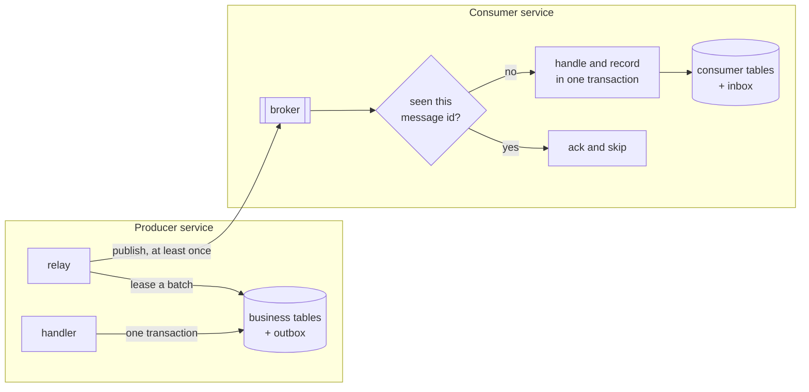

# OutboxKit

[](https://github.com/softvasco/outbox-kit/actions/workflows/ci.yml)
[](LICENSE)

Transactional outbox and inbox for .NET. A message is saved in the same database transaction as the data that caused it, a relay delivers it at least once, and the consumer side makes sure it is handled once.

Early days: the repo has the skeleton and the plan, the code comes next. Everything below describes where it is going, not what works today.

## Why

A handler that saves an order and then publishes `OrderPlaced` to a broker does two writes that can't share a transaction. If the process dies between them, or the broker is down, the order exists and nobody hears about it. Publishing first is worse: the event goes out for an order that was rolled back.

The outbox fixes the producer side by writing the message to a table in the same transaction as the order. A relay reads that table and publishes. That gives at-least-once delivery, so the consumer side needs an inbox that remembers which messages it already handled.

Most .NET teams get this from a full messaging framework. I want the outbox and inbox on their own, small enough to read in an evening, working the same way on SQL Server and PostgreSQL, with tests that kill the relay halfway through a batch.

## How it fits



## Plan

- Core model and an `IOutbox` that enqueues inside the caller's transaction (ADO.NET and EF Core).
- A relay that leases batches with `SKIP LOCKED` on PostgreSQL and `READPAST` on SQL Server, so several instances can run at once.
- Ordering per key, retries with backoff, and a dead-letter state.
- Transports behind one port, starting with an in-memory one for tests.
- An inbox keyed by message id and consumer name.
- The same contract tests run against both databases with Testcontainers.

## Building

```bash
dotnet build
dotnet test
```

Needs the .NET 10 SDK.
