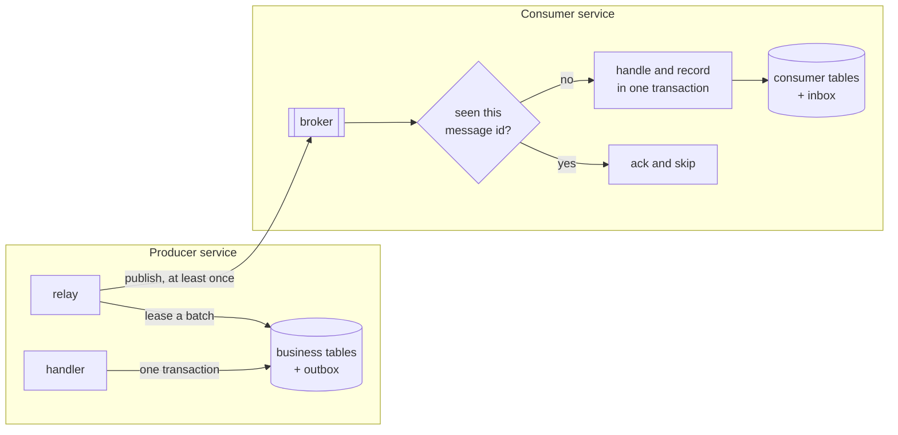

# OutboxKit

[](https://github.com/softvasco/outbox-kit/actions/workflows/ci.yml)
[](LICENSE)

Transactional outbox and inbox for .NET. A message is saved in the same database transaction as the data that caused it, a relay delivers it at least once, and the consumer side makes sure it is handled once.

Early days: messages can be saved with the caller's transaction (ADO.NET or EF Core), and a hosted dispatcher claims them from PostgreSQL or SQL Server and sends them through a transport you plug in. Failed sends are retried with backoff, messages for one ordering key go out in order, and the inbox comes next, so nothing ships ready to publish yet.

## Why

A handler that saves an order and then publishes `OrderPlaced` to a broker does two writes that can't share a transaction. If the process dies between them, or the broker is down, the order exists and nobody hears about it. Publishing first is worse: the event goes out for an order that was rolled back.

The outbox fixes the producer side by writing the message to a table in the same transaction as the order. A relay reads that table and publishes. That gives at-least-once delivery, so the consumer side needs an inbox that remembers which messages it already handled.

Most .NET teams get this from a full messaging framework. I want the outbox and inbox on their own, small enough to read in an evening, working the same way on SQL Server and PostgreSQL, with tests that kill the relay halfway through a batch.

## How it fits



## Saving a message

With ADO.NET, pass the transaction you already have. The row is written on its connection, so it commits or rolls back with your own writes:

```csharp
await using var transaction = await connection.BeginTransactionAsync(ct);
// ... insert the order with the same transaction
await outbox.EnqueueAsync(new OrderPlaced(order.Id), transaction, orderingKey: $"order-{order.Id}", ct);
await transaction.CommitAsync(ct);
```

With EF Core, map the table once and enqueue on the context. The message is only tracked; the next `SaveChanges` writes it together with your entities:

```csharp
protected override void OnModelCreating(ModelBuilder modelBuilder) => modelBuilder.AddOutboxMessages();

db.Orders.Add(order);
dbContextOutbox.Enqueue(db, new OrderPlaced(order.Id));
await db.SaveChangesAsync(ct);
```

If your aggregates raise their own messages, implement `IHasOutboxMessages` on them and add the interceptor instead. Every `SaveChanges` takes the messages from the tracked entities and writes them in the same transaction:

```csharp
options.UseSqlServer(connectionString).AddInterceptors(new OutboxSaveChangesInterceptor(dbContextOutbox));

public IReadOnlyList<PendingOutboxMessage> TakeOutboxMessages()
{
    var taken = _raised.ToList();
    _raised.Clear();
    return taken;
}
```

Taking clears them, so saving the context twice doesn't write a message twice.

Both write the same table and columns (`outbox_messages` by default), so one service can use either.

## Sending messages

The dispatcher runs as a hosted service. It claims a batch of pending messages from an `IOutboxStore`, hands each one to your `IMessageTransport` in order, and marks it dispatched after the send succeeds:

```csharp
builder.Services.AddSingleton<IOutboxStore>(new PostgreSqlOutboxStore(NpgsqlDataSource.Create(connectionString), new OutboxTable()));
// or new SqlServerOutboxStore(SqlClientFactory.Instance.CreateDataSource(connectionString), new OutboxTable())
builder.Services.AddSingleton<IMessageTransport, ServiceBusTransport>();
builder.Services.AddOutboxDispatcher(o =>
{
    o.PollingInterval = TimeSpan.FromSeconds(1);
    o.BatchSize = 100;
    o.ClaimDuration = TimeSpan.FromSeconds(30);
    o.Retry = new OutboxRetryPolicy { MaxAttempts = 10, FirstDelay = TimeSpan.FromSeconds(1), MaxDelay = TimeSpan.FromMinutes(5) };
});
```

Every instance of the service can run the dispatcher. A claim sets `claimed_until` on the batch in one statement, using `FOR UPDATE SKIP LOCKED` on PostgreSQL and `READPAST` on SQL Server, so relays polling at the same time get different messages instead of waiting on each other. If an instance dies, its batch is claimed again once the claim runs out. [ADR 2](docs/adr/0002-claim-batches-with-a-lease.md) has the reasoning.

Messages with the same ordering key go out in the order they were saved. The claim skips a message while an older one for its key is still pending, so a batch holds at most one message per key and two relays never work on the same key. Messages for other keys, or with no key, aren't held up. [ADR 4](docs/adr/0004-ordering-per-key-in-the-claim-query.md) covers the trade-offs.

A full batch is followed by the next one straight away; it only waits for the polling interval once the outbox is drained. A failed send stops the batch, so later messages for the same key don't overtake it, and the service logs the error. The failed message waits 1, 2, 4... seconds (capped at `MaxDelay`) before any relay takes it again, and the rest of the batch goes out once its claim runs out. After `MaxAttempts` failed sends the message is dead-lettered: it stays in the table with `dead_lettered_at` and `last_error` set, and is never claimed again. [ADR 3](docs/adr/0003-retries-and-dead-letters-in-the-outbox-table.md) explains why that lives in the same table. A crash between the send and the update sends that message again, which is why the consumer side needs an inbox; [docs/delivery.md](docs/delivery.md) lists every case where a message can arrive twice.

## Cleaning up

Dispatched rows are only useful for a while, and a table that grows forever slows down the claim. `AddOutboxRetention` deletes them in the background:

```csharp
builder.Services.AddSingleton<IOutboxRetentionStore>(new PostgreSqlOutboxStore(NpgsqlDataSource.Create(connectionString), new OutboxTable()));
builder.Services.AddOutboxRetention(o =>
{
    o.RetainFor = TimeSpan.FromDays(7);
    o.Interval = TimeSpan.FromHours(1);
    o.BatchSize = 1000;
});
```

It deletes one batch at a time and skips rows another transaction holds, so it doesn't block the relays. Pending and dead-lettered messages are never touched.

## Testing without a broker

`InMemoryTransport` keeps what the dispatcher sends in a channel, in send order, so a test can enqueue in a real transaction, run the dispatcher and read the messages back:

```csharp
var transport = new InMemoryTransport();
builder.Services.AddSingleton<IMessageTransport>(transport);

// ... save an order, let the dispatcher run
var sent = await transport.Sent.ReadAsync(ct);
Assert.Equal("orders.placed", sent.Type);
```

It never fails a send, so a test for retries or dead letters still needs a transport that throws.

## Plan

- Core model and an `IOutbox` that enqueues inside the caller's transaction (ADO.NET and EF Core).
- A relay that leases batches with `SKIP LOCKED` on PostgreSQL and `READPAST` on SQL Server, so several instances can run at once.
- Retries with backoff, and a dead-letter state.
- Ordering per key.
- Transports behind one port: the in-memory one for tests is in, RabbitMQ, Azure Service Bus and Kafka are next.
- An inbox keyed by message id and consumer name.
- The same contract tests run against both databases with Testcontainers.

## Building

```bash
dotnet build
dotnet test
```

Needs the .NET 10 SDK. The store tests start PostgreSQL and SQL Server in Docker through Testcontainers.
